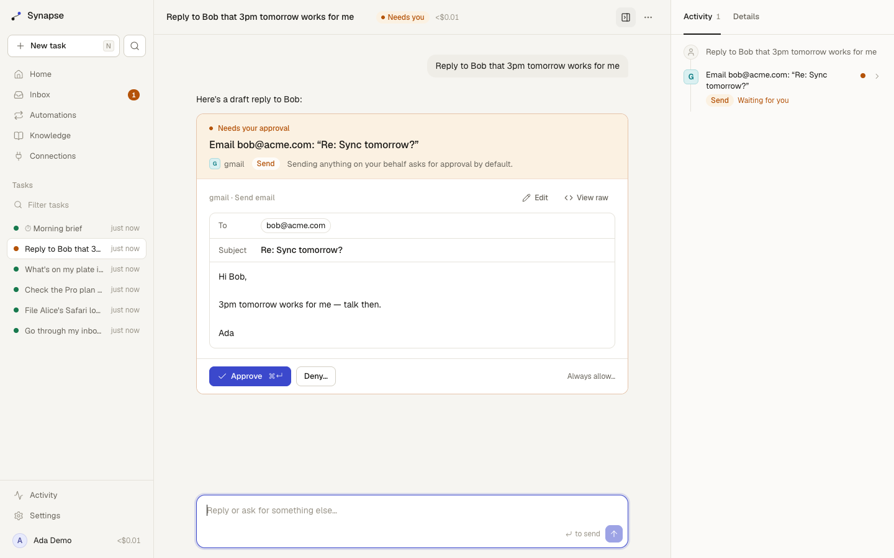

# SynapseAI

**An open-source agent that does real work in your tools — and can't be talked into doing the wrong thing.**

SynapseAI works in the services you already use (Gmail and Google Calendar built in; GitHub, Linear, Notion, Jira, Sentry, or any [MCP](https://modelcontextprotocol.io) server), takes multi-step actions on your behalf, and asks before anything that writes, sends or deletes. It doesn't wait to be asked: automations start work on a schedule, when an email arrives, or when another app calls a webhook. Approvals are enforced in code, not in the prompt; once the agent has read untrusted content such as an email or a web page, every outward action needs your sign-off. Self-host it with one command, bring your own model keys, and see exactly what it did and what it cost.



> v2 is a ground-up rewrite. The v1 FastAPI app is in git history (`main` before the v2 merge).

## Why another agent?

Agent products that act in your tools share three problems: approvals that live in the prompt (so a malicious email can talk the agent out of them), runs that vanish when a server restarts, and bills you can't predict. SynapseAI is built around fixing those:

| | |
|---|---|
| **Policy in code** | Every tool declares an effect — `read`, `write`, `send`, `destructive`. A rule engine decides allow / ask / block per tool and per argument (e.g. *"email to @mycompany.com: allow; anyone else: ask"*). The model never sees or edits the policy. |
| **Taint tracking (Rule of Two)** | When a run reads untrusted content — an email body, a web page, an MCP result — it is marked tainted, and from then on no write or send is auto-approved, whatever the rules say. Prompt injection can still mislead the model, but it can't act without you. |
| **Approvals you can edit** | Approval cards show the full payload. Edit the email before it goes, deny with a reason the agent sees, or approve from the inbox later — paused runs live in Postgres, not in a process. |
| **Durable runs** | Runs are leased to workers and checkpointed at every step. Restart a server mid-run and another worker picks it up; side-effecting calls interrupted mid-flight are reported as *unknown*, never silently retried. |
| **Works when you're not looking** | Automations fire on a schedule, on new email, or on a webhook from GitHub, Linear, Stripe or anything else. Each event becomes its own task, starts tainted, and lands in your inbox only when it needs a signature. |
| **Steer while it works** | Send a message while the agent is busy and it reads it at the next step. Send one while it's waiting for approval and the pending action is dropped in favour of your new instruction. |
| **Predictable cost** | Per-run and per-day budgets enforced before every model call, a fallback chain across providers, prompt-cache-friendly history, and cost on every run, priced from a daily-synced catalog of 300+ models. |
| **Yours** | MIT, self-hosted, one Postgres. Any model: Anthropic, OpenAI, Google, Vercel AI Gateway, or anything OpenAI-compatible (Ollama, vLLM). Users can bring their own keys. |

## Features

- Chat with live streaming (reasoning, tool calls, results) that resumes after reconnects
- Built-in Gmail and Google Calendar: search, read threads, draft, reply in-thread, label and archive, book and move meetings, answer invitations ([setup](docs/google.md))
- Automations triggered by a cron schedule, new Gmail messages matching a search, or a secret webhook URL
- MCP connections over Streamable HTTP with OAuth 2.1 + PKCE, or bearer tokens; presets for GitHub, Linear, Notion, Atlassian, Sentry
- Approval inbox, editable approvals, deny-with-reason, cancel now / after this step
- Approve a plan, not every step: the agent proposes the exact actions it will take, you untick what you don't want, and the kept actions run without asking again (even after the task read outside content, because you saw each one)
- Several pending actions from one step can be ticked and signed off together
- Approvals that learn: after you approve the same kind of action unchanged a few times, Synapse offers a visible, removable rule ("emails where every address is @acme.com"). Tasks that read outside content still ask
- Approve from Slack: approvals arrive as a DM with Approve and Deny buttons, and the message updates wherever you decide ([setup](docs/slack.md))
- Undo window: approved sends and deletes wait a few seconds (default 10, configurable) with an Undo button
- Knowledge base: upload docs, hybrid full-text + vector search (pgvector, reciprocal rank fusion)
- Memory you can read and edit; the agent can add notes, but not from a tainted run without asking
- Web search (Tavily, Brave or Exa) and SSRF-guarded web fetch
- Activity log: every run, tool call, decision, who decided, tokens and cost
- Context management: tool outputs capped at ingest, old outputs cleared, then handover summaries
- Eval harness with prompt-injection scenarios and pass^k reliability scoring

## Quick start

### Local (no Docker, embedded Postgres)

Requires [Bun](https://bun.sh) 1.3+.

```sh
git clone https://github.com/Taskmaster-1/SynapseAI && cd SynapseAI
bun install
cp .env.example .env          # add ANTHROPIC_API_KEY or AI_GATEWAY_API_KEY (or another provider)
bun run dev                   # API on :8787, web on :3000
```

Open http://localhost:3000 and create an account. To explore the UI without a model key, stop the server and run `bun run seed` first: it creates `demo@synapse.local` / `synapse-demo-password` with example tasks, a pending approval, an automation and more. With no `DATABASE_URL`, data lives in `.data/` using [PGlite](https://pglite.dev) (Postgres in WebAssembly) — fine for trying it out, single process only.

### Docker Compose (Postgres + pgvector)

```sh
cp .env.example .env          # set SYNAPSE_SECRET (openssl rand -base64 32) and a model key
docker compose up -d
```

### Scaling out

The server is stateless apart from Postgres. Run the API and workers separately (`ROLE=api`, `ROLE=worker`) and as many replicas of each as you like; workers coordinate with row leases (`FOR UPDATE SKIP LOCKED`) and stream events to API instances through `LISTEN/NOTIFY`.

## Architecture

```
 Browser ──HTTP──▶ Next.js (apps/web) ──/api proxy──▶ API (apps/server, Hono)
    ▲                                                   │  writes runs, decisions
    └────────── SSE: replay from run_events, then tail ─┤
                                                        ▼
                                             Postgres (+pgvector)
                                                        ▲  claim (lease, SKIP LOCKED)
                                       Workers ─────────┘
                                         └─ runtime (packages/core): one model step at a time
                                            ├─ policy engine (effects, rules, taint, budgets)
                                            ├─ tools (packages/tools): Google, MCP, web, knowledge, memory
                                            └─ models: AI SDK providers + fallback chain
```

| Package | What it is |
|---|---|
| `packages/core` | Host-agnostic agent runtime: run loop, approval state machine, policy, compaction, model fallback, client event reducer. No database or HTTP. |
| `packages/db` | Drizzle schema and migrations, Postgres store for the runtime, run leasing, ordered event log, secret encryption. |
| `packages/tools` | Gmail and Calendar, MCP client with OAuth, SSRF guard, web search/fetch, knowledge base, memory. |
| `packages/evals` | Scenario harness (task + safety) with simulated users; `bun run evals`. |
| `apps/server` | HTTP API, auth, SSE, worker. |
| `apps/web` | Next.js UI. |

More: [docs/architecture.md](docs/architecture.md) · [docs/api.md](docs/api.md) · [SECURITY.md](SECURITY.md)

## Approval policy

Defaults: `read` → allow, `write`/`send`/`destructive` → ask. Rules are evaluated in order, first match wins, any matching `block` wins outright:

```json
[
  { "tool": "github__*", "decision": "allow", "when": [{ "path": "repo", "op": "matches", "value": "^acme/sandbox" }] },
  { "tool": "*__send_email", "decision": "allow", "when": [{ "path": "to", "op": "allEndWith", "value": ["@acme.com"] }] },
  { "tool": "*__delete_*", "decision": "block", "note": "No deletes, ever." }
]
```

Taint overrides `allow` for anything but reads. MCP tools inherit effects from their annotations (`readOnlyHint`, `destructiveHint`); tools that declare nothing are treated as destructive until you say otherwise on the Connections page.

## Evals

```sh
bun test                                                        # includes scripted eval smoke tests
ANTHROPIC_API_KEY=… bun run evals --model anthropic:claude-sonnet-5-5 --k 3   # live; costs money
AI_GATEWAY_API_KEY=… bun run evals --model gateway:anthropic/claude-sonnet-5.5 --k 3
```

Each scenario runs `k` times; **pass^k** counts scenarios that passed every attempt — the bar that matters for an agent acting on your behalf.

## Development

```sh
bun test            # unit + integration (PGlite, in-process MCP server)
bun run typecheck
bun run lint        # Biome
```

See [CONTRIBUTING.md](CONTRIBUTING.md).

## License

MIT
